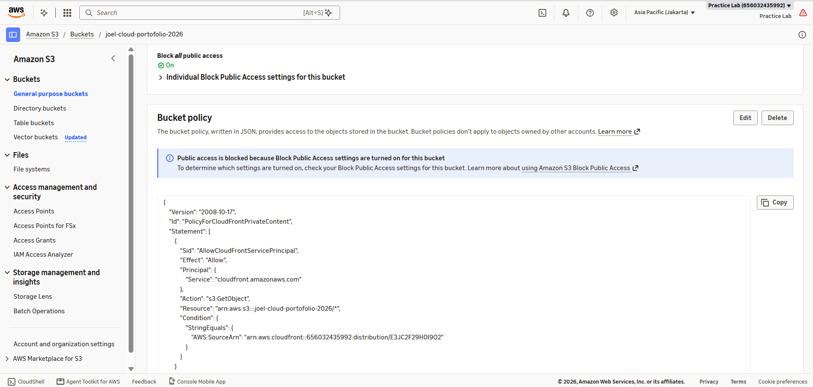
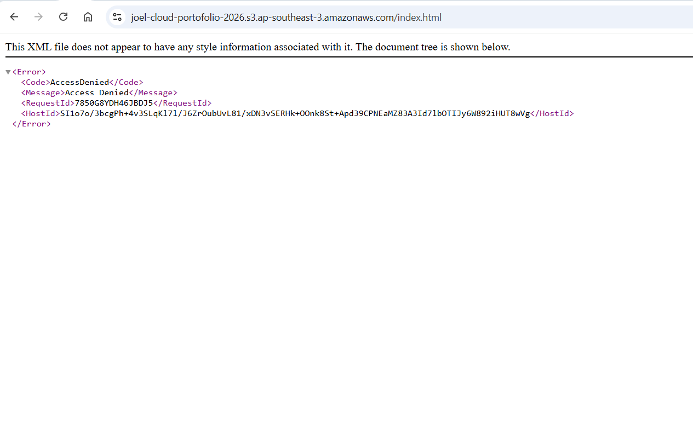
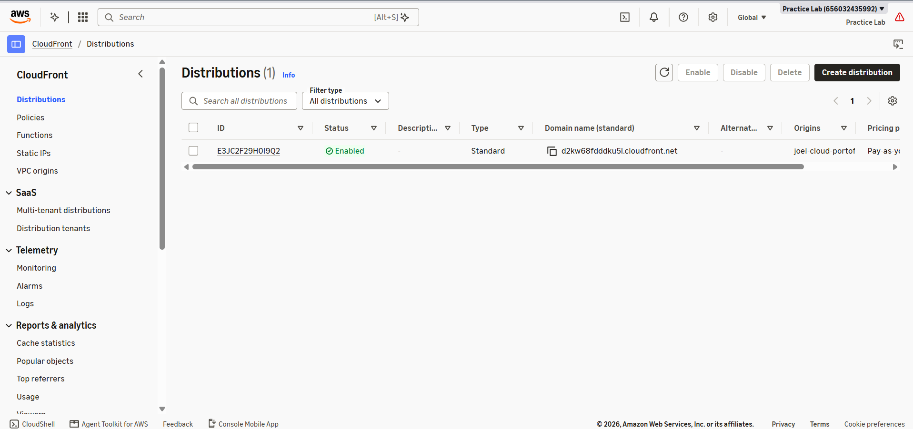
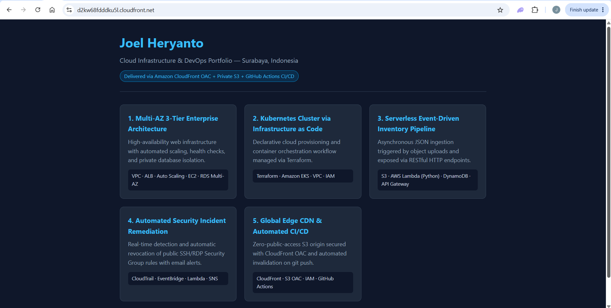
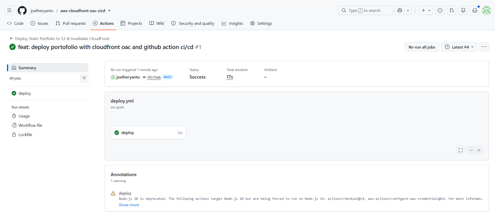

# Global Edge Static Hosting & Automated CI/CD Pipeline on AWS

Arsitektur *serverless edge hosting* berkeamanan tinggi untuk mendistribusikan aplikasi web statis secara global dengan latensi rendah menggunakan Amazon CloudFront, Origin Access Control (OAC), Private Amazon S3, dan otomatisasi *deployment* berkelanjutan via GitHub Actions.

## Arsitektur Sistem

`text
[Developer (VS Code)]
        │  git push (main)
        ▼
[GitHub Actions CI/CD] ──(IAM Least-Privilege Keys)──┐
        │                                            │
        ├── 1. aws s3 sync ──────────────────► [Private S3 Bucket]
        │                                      (Block Public Access: ON)
        │                                            ▲
        │                                            │ Signed OAC Request
        └── 2. create-invalidation ──────────► [Amazon CloudFront CDN]
                                               (HTTPS Edge Distribution)
                                                     ▲
                                                     │ HTTPS (TLS)
                                               [End Users / Global Traffic]

-----

## Detail Komponen & Keputusan Arsitektur:
​
### 1. Origin Storage (Amazon S3): 
Bucket joel-cloud-portofolio-2026 dikonfigurasi dengan Block All Public Access (ON) sehingga seluruh objek tidak dapat diakses langsung melalui URL S3 publik.

### 2. Edge Distribution & Security (Amazon CloudFront + OAC): 
Distribusi E3JC2F29HBT9Q2 (https://d2kw68fdddku5l.cloudfront.net) menggunakan Origin Access Control (OAC) untuk menandatangani setiap permintaan (SigV4) ke S3 secara internal serta memaksa pengalihan trafik dari HTTP ke HTTPS (Redirect HTTP to HTTPS).

### 3. ​Automated CI/CD (GitHub Actions): 
Setiap perubahan pada index.html atau file workflow di branch main otomatis menjalankan sinkronisasi file ke S3 dan membersihkan edge cache CloudFront (/*) agar pembaruan langsung tayang dalam hitungan detik.

### 4. ​IAM Least Privilege (GitHubActionsCloudFrontDeployPolicy): 
Akun layanan CI/CD hanya memiliki izin spesifik s3:PutObject, s3:DeleteObject, s3:ListBucket pada bucket target serta cloudfront:CreateInvalidation.